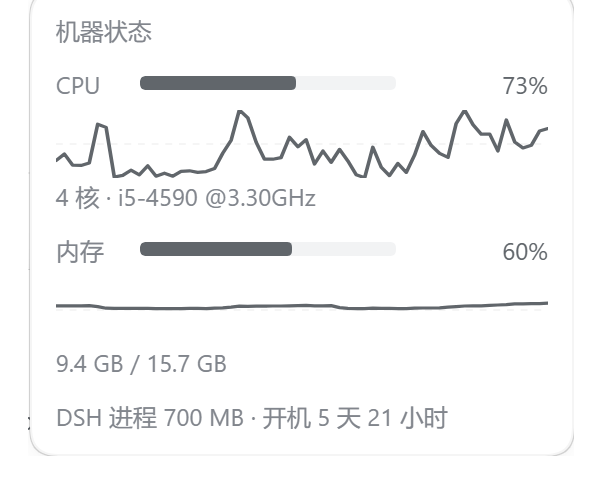

# dsh-sysmon

在 [DeepSeek Harness](https://github.com/deepseek-ai/deepseek-harness)（dsh）输入卡片正下方显示本机 **CPU / 内存** 的圆环水位，点一下展开一分钟走势与明细。

English | [中文](#中文)

```text
… 费用明细 本会话 ¥0.5181 · 命中 98.8% │ CPU ◔ 26% │ 内存 ◕ 56% │ ◯ 28%
                                       └── 本插件 ──┘
```




## 中文

### 功能

- **行内**：`CPU ◔ 26%` + `内存 ◕ 56%` 两个小圆环 + 百分比。圆环几何照抄宿主自带的上下文用量圆圈
  （ContextMeter）：14px 视框、半径 5.5、2px 描边、底环 `--dsw-alias-border-l3`、从 -90° 顺时针画。
- **警示**：正常走中性色，≥75% 转黄（`--dsw-alias-state-warn-primary`）、≥90% 转红（`--dsw-alias-state-error-primary`），环和数字一起变色。
- **点开**：面板里给 CPU / 内存各一条一分钟走势（带 50% 虚线参考线），外加核数与 CPU 型号、
  内存已用/总量、磁盘占用、DSH 进程常驻内存、开机时长。点面板外面或按 Esc 收起。
- **省电**：前台每 2s 取一次数，标签页隐藏降到 15s，连续失败退避到 10s；采样在宿主侧按 1s 走。
- **双语**：文案跟随 DSH 界面语言（中/英），取不到语言服务时中文兜底。
- **零依赖**：只有 `node:os` / `node:fs`，不装任何第三方包，不起子进程。

### 安装

从 GitHub 直接装（`web` 换成你的 profile 名）：

```bash
dsh plugin --profile web add github:hehf21/dsh-sysmon
```

装完**刷新页面**。卸载：

```bash
dsh plugin --profile web remove dsh-sysmon
```

桌面版（Electron）的 profile 由应用独占，CLI 装不了——改在侧栏 **插件** 页里安装/启用/停用。

注意：浏览器半边改动关一下插件再开就重新组合、刷新即见；宿主半边（`index.js`）是进程内 ESM 模块，
改了必须**重启 dsh** 才换代。

### 实现

```text
浏览器 client.js                        宿主进程 index.js
┌─────────────────────┐    GET      ┌──────────────────────────────┐
│ conversation        │ ──────────► │ /sysmon/stats（精确路由）      │
│ .composer.dock      │ ◄────────── │  ├ node:os  cpus() 时间片差    │
│ 两个圆环 + 点开面板  │    JSON     │  ├ node:os  totalmem/freemem  │
└─────────────────────┘             │  ├ node:fs  statfs 磁盘        │
                                    │  └ 1s 采样 → 60 格走势窗口     │
                                    └──────────────────────────────┘
```

| 文件 | 作用 |
|---|---|
| `index.js` | 宿主半边：1s 采样 CPU 时间片差、内存占用、每 15s 采一次磁盘，维护 60 格走势窗口，注册 `GET /sysmon/stats`。 |
| `client.js` | 浏览器半边：`window.__ModuleLoader__.load` 注册工厂，`ctx.slots.inject('conversation.composer.dock', …)` 挂条目，轮询渲染。 |
| `cordis.patch.yml` | 插入宿主插件行 `sysmon`；行 id 决定浏览器半边的加载地址 `/plugins/sysmon/client.js`。 |

### 取值口径

- **CPU**：两次 `os.cpus()` 累计时间片之差，`1 - idleΔ/totalΔ`，跨全部核心加权；采样间隔内没有新时间片时保留上一次读数，避免曲线出现假谷底。
- **内存**：`(totalmem - freemem) / totalmem`。Windows 上 `freemem` 是「可用」内存，与任务管理器「使用中」同口径。
- **磁盘**：`fs.promises.statfs(<用户主目录所在盘>)`，Windows 上即 `C:\`；读取失败时该行不显示。
- 走势窗口是宿主侧的 60 格（约一分钟），客户端只读不算。

### 边界

- 只在**会话视图**渲染：`conversation.composer.dock` 的渲染条件是会话已存在，欢迎页（新会话空态）不显示。
- `/sysmon/stats` 不在 `/api` 前缀下，因此不走连接插件的浏览器信任栅栏：**能打开本机页面的本机进程**都能读到
  这几个数字（CPU/内存/磁盘占用率，无敏感信息）。dsh 桌面版只绑 `127.0.0.1`；如需收紧，在 `index.js`
  的 `handle()` 里加 Host / Origin 白名单。
- 无配置项。采样与轮询间隔是源码常量：宿主 `SAMPLE_MS`、客户端 `POLL_MS`。

### 与同类插件

同类开源实现另有 [hnmrxz/dsh-plugin-sysmon](https://github.com/hnmrxz/dsh-plugin-sysmon)（同槽位的状态胶囊）、
[AKS1st/dsh-sysmon](https://github.com/AKS1st/dsh-sysmon)（右下角悬浮窗）、
[Small-Miao/dsh-statusbar](https://github.com/Small-Miao/dsh-statusbar)（`shell.overlay` 整条底栏）。
本插件的磁盘 / 点击刷新 / 双语思路参考了第一个。

## English

Host CPU / memory rings under the dsh composer, with a one-minute trend panel on click.

- **Inline**: two 14px rings (same geometry as dsh's own context meter) plus percentages; amber at ≥75%, red at ≥90%.
- **On click**: a panel with a one-minute trend line per metric (dashed 50% reference), core count and CPU model,
  memory used/total, disk usage, the dsh process RSS, and host uptime.
- **Cost-aware**: 2 s polling in the foreground, 15 s while hidden, 10 s back-off after repeated failures;
  sampling happens host-side at 1 s.
- **Zero dependencies**: `node:os` / `node:fs` only — no third-party packages, no subprocesses.

Install (replace `web` with your profile name):

```bash
dsh plugin --profile web add github:hehf21/dsh-sysmon
```

Then refresh the page. The Electron desktop profile is managed by the app, so install it from the sidebar
**Plugins** page instead. Client-half changes reload by toggling the plugin; host-half changes need a dsh restart
(the host module is an in-process ES module cached by URL).

## License

MIT
